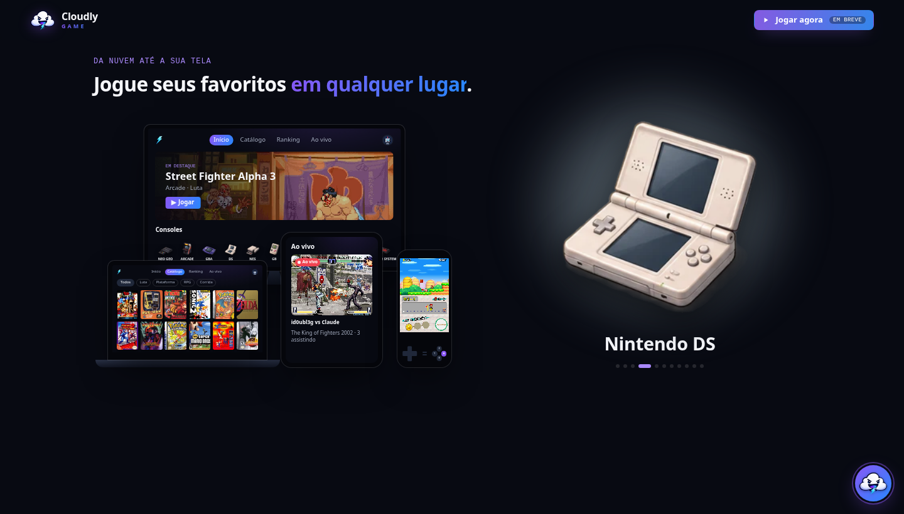
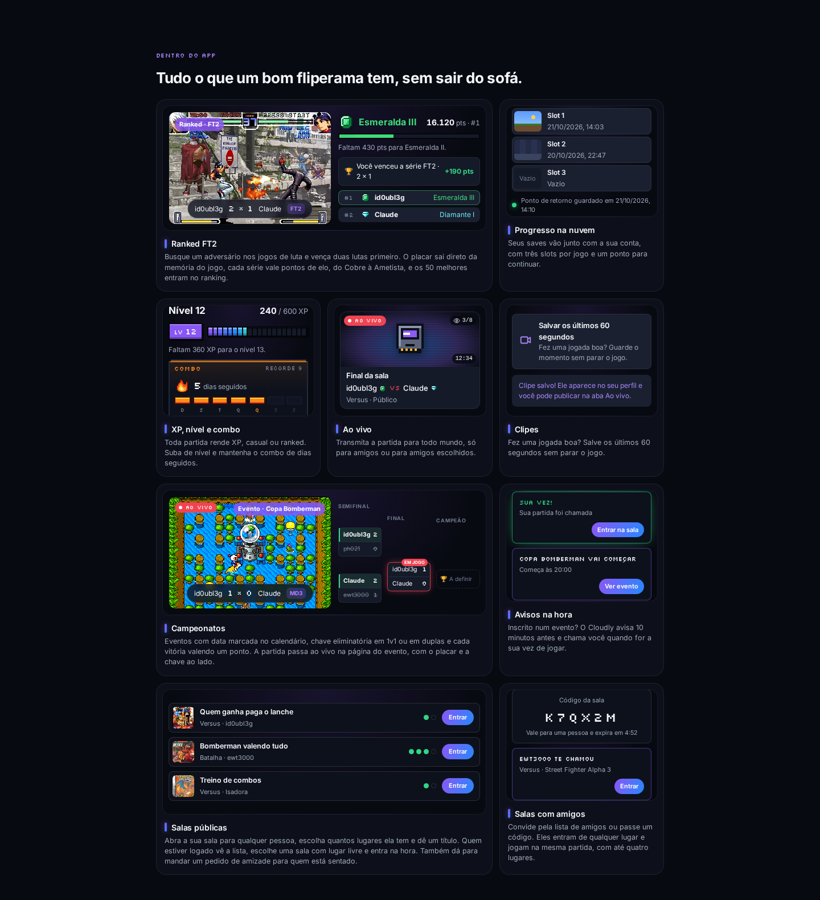
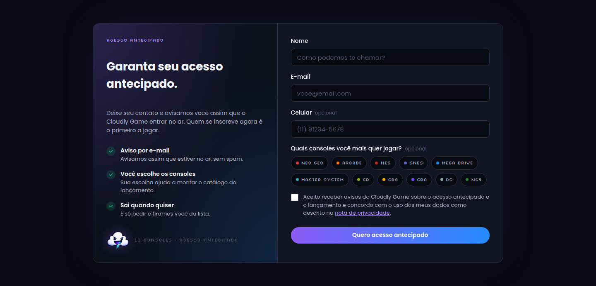
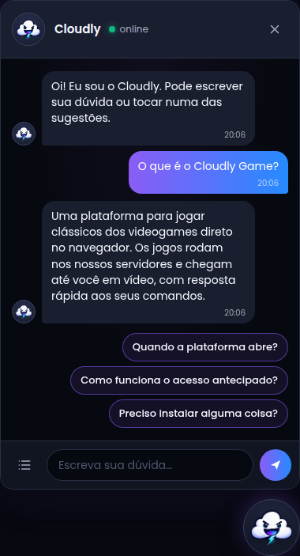

# Cloudly Game Landing

<!-- markdownlint-disable MD033 -->

<div align="center">
  
  <h1><b>Cloudly Game Landing</b></h1>
  <p>Landing page that presents Cloudly Game and collects early access sign-ups by email, before the platform goes live.</p>
</div>

<p align="center">
  
</p>

<!-- markdownlint-enable MD033 -->

## Table of Contents

- [Overview](#overview)
- [Features](#features)
- [Sections](#sections)
- [Project Structure](#project-structure)
- [Prerequisites](#prerequisites)
- [Configuration](#configuration)
- [Running the Page](#running-the-page)
- [Example Use Case](#example-use-case)
  - [From the First Visit to the Sign-Up](#from-the-first-visit-to-the-sign-up)
  - [Asking Cloudly a Question](#asking-cloudly-a-question)
- [How Sign-Ups Work](#how-sign-ups-work)
- [How the Help Chat Works](#how-the-help-chat-works)
- [How the Page Follows the App](#how-the-page-follows-the-app)
- [License](#license)

## Overview

Cloudly Game Landing is a static page, with plain HTML, CSS and JavaScript and no build step, that presents [Cloudly Game](https://github.com/id0ubl3g/cloud-game-react) to people who have not played it yet and gathers early access sign-ups. It shows the consoles in the catalog, the main features drawn as real pieces of the app interface, a short level-select walkthrough and a sign-up form. Each sign-up is sent by email to the Cloudly Game inbox through Web3Forms, so nothing is stored in the [Cloud Game Flask API](https://github.com/id0ubl3g/cloud-game-flask-api) or in a database. Cloudly, the mascot, sits in the corner as a help chat that answers the frequent questions.

## Features

- Opening screen with the headline, the highlights (consoles, players per match, nothing to install), the early access button and the eleven consoles side by side, all on the first screen from phones to wide monitors
- Consoles shown as round badges with the same colors and glyphs as the console shelf of the app
- Features in six equal squares, each with a piece of the app interface: a live card, the clip button, a room with online and local seats, save slots with the resume point, the rank with the XP bar and the daily combo, and the devices it runs on
- **Como funciona** as a level select: three stages joined by a dotted trail and a boss stage that leads to the sign-up form
- Early access form in one card with two panes, like the sign-in screen of the app: name, email, an optional Brazilian mobile number, the consoles the person most wants to play and the consent to receive emails
- Sign-ups sent by email through Web3Forms, with the traffic source (`utm_*` and the referring site) and the consent time, a notice when the email service is slow and an error that tells a slow service apart from a lost connection
- Hidden field that catches bots: they get the same thank you and nothing is sent
- Help chat with Cloudly in the corner: twelve frequent questions as suggestions, a list of all of them, and typed questions matched by keywords
- Privacy note in a popup, opened from the consent text of the form
- In-page links that put the section in the middle of the screen
- Brand look from the app: dark surfaces, the purple and blue gradient, Poppins and the Silkscreen pixel font, pill buttons and the pixel art sprites of the app
- Works with the keyboard, follows the reduced motion setting of the system and has no horizontal scroll on phones

<!-- markdownlint-disable MD033 -->

<p align="center">
  
</p>

<!-- markdownlint-enable MD033 -->

## Sections

| Anchor | Section |
| ------ | ------- |
| `#abertura` | Headline, highlights, buttons and consoles |
| `#recursos` | Features in six squares |
| `#como-funciona` | Level select from choosing a game to the sign-up |
| `#lista` | Early access form |
| `#privacidade` | Privacy note popup |
| `#ajuda` | Help chat with Cloudly |

## Project Structure

```plaintext
└── landing_page/
  ├── .github/
  │   ├── cloud-gaming-logo.png
  │   ├── cloudly.png
  │   ├── features.png
  │   ├── home.png
  │   └── signup.png
  ├── assets/
  │   ├── pixel/
  │   │   ├── alien.svg
  │   │   ├── cartridge.svg
  │   │   ├── flame.svg
  │   │   ├── gato.svg
  │   │   ├── heart.svg
  │   │   ├── ninja.svg
  │   │   ├── rankDiamond.svg
  │   │   ├── rankGold.svg
  │   │   ├── robo.svg
  │   │   ├── stopwatch.svg
  │   │   └── token.svg
  │   ├── apple-touch-icon.png
  │   ├── favicon.png
  │   ├── logo.png
  │   └── mascot.png
  ├── index.html
  ├── LICENSE
  ├── main.js
  ├── README.md
  └── styles.css
```

The pixel art in `assets/pixel/` is exported from `src/sprites.ts` of the frontend, and the icons, logo and mascot come from its `public/` folder.

## Prerequisites

To run Cloudly Game Landing, any static file server is enough, such as Python 3 (`python3 -m http.server`), and a recent browser. A [Web3Forms](https://web3forms.com) access key created for the inbox that receives the sign-ups is needed for the form.

## Configuration

The form settings are at the top of `main.js`:

| Constant | Description |
| -------- | ----------- |
| `FORM_ENDPOINT` | Web3Forms API address, `https://api.web3forms.com/submit` |
| `FORM_ACCESS_KEY` | Web3Forms access key of the Cloudly Game inbox. It only lets the form send to that inbox, so it is meant to be public |
| `SLOW_NOTICE_MS` | Time before the form says the email service is slow, `5000` by default |
| `SUBMIT_TIMEOUT_MS` | Time the form waits for the email service before showing an error, `120000` by default |

The list of consoles, with their names, colors and glyphs, is in `PLATFORMS` and `GLYPHS`, and the help chat questions and answers are in `HELP_QUESTIONS`, also in `main.js`.

## Running the Page

```sh
cd landing_page
python3 -m http.server 8000
```

Open `http://localhost:8000`. Serve the page over HTTP instead of opening `index.html` as a file, so the browser sends the form from a regular web origin.

To publish it, upload the folder to any static host. Web3Forms only accepts sign-ups sent from a regular browser: requests from servers, scripts and headless browsers are blocked by its firewall.

## Example Use Case

### From the First Visit to the Sign-Up

1. The person opens the page and sees the headline, the highlights and the eleven consoles on the first screen.
2. **Ver como funciona** puts the level select in the middle of the screen, and the boss stage **Continuar ▸** goes to the form. **Quero acesso antecipado** goes straight there.
3. The person fills in the name and email, optionally the mobile number and the consoles, accepts the consent and presses **Quero acesso antecipado**.
4. The form checks the fields in the browser and sends the sign-up. If the email service takes more than 5 seconds, the page says so and keeps waiting.
5. The card shows **Acesso antecipado garantido!**, and the Cloudly Game inbox receives an email titled **Novo inscrito no acesso antecipado** with the answers, the traffic source and the consent time. Replying to it writes to the person who signed up.

<!-- markdownlint-disable MD033 -->

<p align="center">
  
</p>

<!-- markdownlint-enable MD033 -->

### Asking Cloudly a Question

1. A few seconds after the page opens, Cloudly says hello next to the button in the corner.
2. Pressing the button, or **Perguntas** in the header, opens the chat with a greeting and four suggestions.
3. A suggestion, or a typed question such as "funciona no iphone?", gets an answer after a short typing animation, followed by new suggestions.
4. The list button next to the text field opens all the questions. Escape closes the list first and then the chat.

## How Sign-Ups Work

1. On the first visit, the page reads the `utm_source`, `utm_medium`, `utm_campaign`, `utm_term` and `utm_content` parameters and the referring site, and keeps them for the tab, so the source of the first visit is the one that is sent.
2. When the form is sent, the browser checks the name, the email format, the mobile number (area code and 9 digits) and the consent. If the hidden field was filled, the page shows the thank you and sends nothing.
3. The sign-up goes to Web3Forms as a regular form post, with the access key, the subject, the sender name **Cloudly Game**, the reply address, the name, email, mobile number, consoles, traffic source and consent time. A regular form post avoids the CORS preflight that the Web3Forms firewall rejects.
4. While the request runs, the button shows a spinner. After 5 seconds the page says the email service is slow, and after 2 minutes it gives up.
5. When Web3Forms answers `success: true`, the form is replaced by the thank you message. Otherwise the page asks to try again, or to check the connection when the browser is offline.

## How the Help Chat Works

<!-- markdownlint-disable MD033 -->

<p align="center">
  
</p>

<!-- markdownlint-enable MD033 -->

1. The chat answers twelve frequent questions about the platform, from what Cloudly Game is to how XP and ranks work. Questions about things that are not decided yet, such as the price, are not answered.
2. After each answer, up to three questions that were not asked yet show up as suggestions, and they leave as soon as the conversation moves on.
3. Typed questions are lowercased and stripped of accents, then matched against keywords of each question. The question with the most matching keywords is answered; when nothing matches, Cloudly says it cannot answer that yet and suggests questions.
4. Everything runs in the browser, with no server and no record of what was asked.

## How the Page Follows the App

1. Colors, radii, buttons, the console shelf colors and glyphs, the live card, the room seats, the save slots, the XP bar and the combo tile copy the styles of the frontend, so the page looks like the product.
2. The pixel art (rank icons, avatars, flame, cartridge, stopwatch, heart and token) is generated from the sprite patterns of the frontend and saved as SVG files.
3. The names, numbers and rewards shown in the features match what the platform does, such as eleven consoles, up to four players, three save slots and ranks from Cobre to Ametista.

## License

This project is licensed under the terms of the [Apache License 2.0](http://www.apache.org/licenses/LICENSE-2.0). See the [LICENSE](./LICENSE) file for details.
