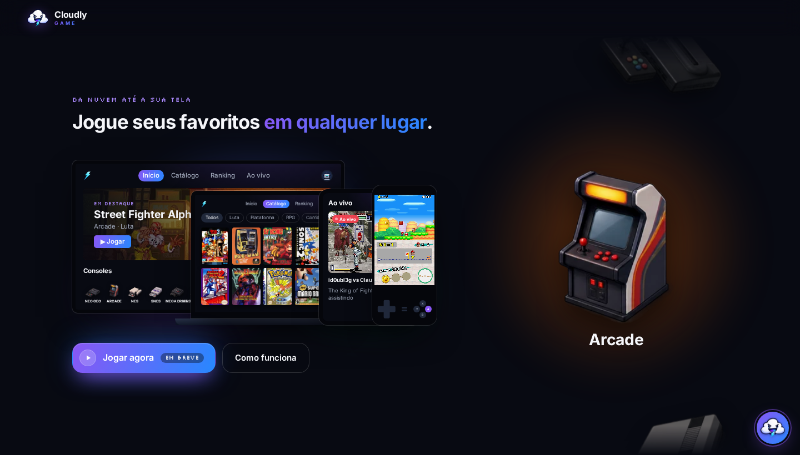
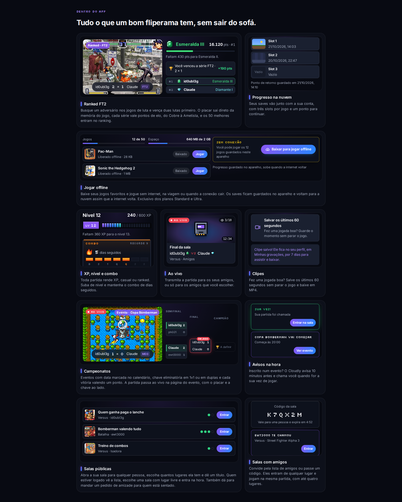
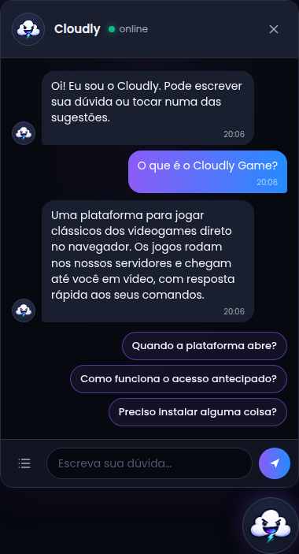

# Cloudly Game Landing

<!-- markdownlint-disable MD033 -->

<div align="center">
  
  <h1><b>Cloudly Game Landing</b></h1>
  <p>Landing page that presents Cloudly Game, its consoles and features, to people who have not played it yet.</p>
</div>

<p align="center">
  
</p>

<!-- markdownlint-enable MD033 -->

## Table of Contents

- [Overview](#overview)
- [Features](#features)
- [Sections](#sections)
- [Project Structure](#project-structure)
- [Prerequisites](#prerequisites)
- [Configuration](#configuration)
- [Running the Page](#running-the-page)
- [Example Use Case](#example-use-case)
  - [From the First Visit to the Product](#from-the-first-visit-to-the-product)
  - [Asking Cloudly a Question](#asking-cloudly-a-question)
- [How the Help Chat Works](#how-the-help-chat-works)
- [How the Page Follows the App](#how-the-page-follows-the-app)
- [License](#license)

## Overview

Cloudly Game Landing is a static page, with plain HTML, CSS and JavaScript and no build step, that presents [Cloudly Game](https://github.com/id0ubl3g/cloudly-game-react) to people who have not played it yet. It opens on one screen with the headline, the app drawn side by side on a TV, a laptop, a tablet and a phone and the play button on the left, and the twelve consoles turning on a roulette wheel on the right. Below it, one section shows the three steps to start playing and the other features, all drawn as real pieces of the app interface. The large **Jogar agora** button under the devices is marked **Em breve** until the platform opens, and the page collects no data. Cloudly, the mascot, sits in the corner as a help chat that answers the frequent questions.

## Features

- Loading screen with Cloudly spitting bolts, the same as in the frontend, that covers the page until its styles, fonts and images are in (fonts and images are waited for 5 seconds at most), so the page never shows unstyled. On the first visit of the session it stays at least 2 seconds
- Opening screen with the slogan **Da nuvem até a sua tela** and the headline on the left, above the app drawn in HTML on four devices in a row, each covering 75% of its width over the one before, and the play buttons: the home with the featured game and the console shelf on a TV, the catalog on a laptop, a live on a tablet and New Super Mario Bros. with the touch controls on a phone
- When the loading screen leaves, the headline comes in letter by letter, as the hero title of the app; the four devices, the play button and the consoles follow, and further down the titles and cards appear in sequence as the page scrolls
- Images that are still loading when the loading screen leaves hold their place with a skeleton, as in the app, and fade in when they arrive; the device under the pointer lifts a little
- The twelve consoles sit on a roulette wheel whose hub is off the right edge of the screen: the console in front is large, with its glow color and name, and the one before and after come in tilted, cut by the screen. The wheel opens with a full spin, then turns on its own and stops while the pointer is over it; it also turns by dragging it, or with the arrow keys once focused, and a strong flick lets it spin free, slow down and land on a random console; the console in front lifts a little under the pointer, as on the console shelf of the app. On narrow screens the wheel turns sideways, with the neighbours cut by the sides of the screen
- A large **Jogar agora** button under the devices, with a light sweeping across it, marked **Em breve** until the platform opens, next to **Como funciona**, which scrolls to the steps. The small one in the header only shows once the large one scrolls away, and the header turns to glass as the page scrolls
- **Como funciona** in one section: three numbered steps to start playing, each drawn as a piece of the app (open in the browser on any device, pick a game in the catalog, call friends to the room), then the other features as cards: ranked, with the FT2 scoreboard over a fighting game, the elo card, the series result and the top of the ranking, save slots with the resume point, offline play with the games kept on the device, the space they take and the **Sem conexão** notice, the level with the XP bar and the daily combo, a live card, the clip button, tournaments, with an event live over Super Bomberman 3 next to its bracket, the event alerts, public rooms, drawn as a list of open rooms with their seats and a join button, and rooms with friends, with the invite code and the invite alert
- Help chat with Cloudly in the corner, opened as a tall rectangle: fifteen frequent questions as suggestions, a list of all of them, and typed questions matched by keywords. On a phone the chat takes the whole screen, follows the area above the keyboard and keeps the keyboard closed until the text field is tapped, so the suggestions stay in sight
- Brand look from the app: dark surfaces, the purple and blue gradient, Poppins and the Silkscreen pixel font, pill buttons and the pixel art sprites of the app
- Works with the keyboard, follows the reduced motion setting of the system and has no horizontal scroll on phones

<!-- markdownlint-disable MD033 -->

<p align="center">
  
</p>

<!-- markdownlint-enable MD033 -->

## Sections

| Anchor | Section |
| ------ | ------- |
| `#abertura` | Headline, the play button, the app on four devices and the consoles on a roulette wheel |
| `#como-funciona` | The three steps to play and the other features |
| `#ajuda` | Help chat with Cloudly |

## Project Structure

```plaintext
└── landing_page/
  ├── .github/
  │   ├── cloudly-game-logo.png
  │   ├── cloudly.png
  │   ├── features.png
  │   └── home.png
  ├── assets/
  │   ├── avatars/
  │   │   └── robo.svg
  │   ├── consoles/
  │   │   ├── arcade.webp
  │   │   ├── ...
  │   │   └── snes.webp
  │   ├── games/
  │   │   ├── bomberman3-screenshot.webp
  │   │   ├── covers/
  │   │   │   ├── 01.webp
  │   │   │   ├── ...
  │   │   │   └── 12.webp
  │   │   ├── kof2002-screenshot.webp
  │   │   ├── nsmb-screenshot.webp
  │   │   └── sfa3-screenshot.webp
  │   ├── pixel/
  │   │   ├── alien.svg
  │   │   ├── cartridge.svg
  │   │   ├── flame.svg
  │   │   ├── gato.svg
  │   │   ├── heart.svg
  │   │   ├── rankDiamond.svg
  │   │   ├── rankEmerald.svg
  │   │   ├── robo.svg
  │   │   └── stopwatch.svg
  │   ├── apple-touch-icon.png
  │   ├── favicon.png
  │   ├── logo.png
  │   ├── mascot-sm.png
  │   └── mascot.png
  ├── index.html
  ├── LICENSE
  ├── main.js
  ├── README.md
  └── styles.css
```

The pixel art in `assets/pixel/` and `assets/avatars/` is exported from `src/sprites.ts` of the frontend, and the icons, logo and mascot come from its `public/` folder. `assets/games/` holds the covers and screenshots of catalog games shown on the devices of the opening screen, and `assets/consoles/` the console artwork of the app.

## Prerequisites

To run Cloudly Game Landing, any static file server is enough, such as Python 3 (`python3 -m http.server`), and a recent browser.

## Configuration

Everything lives in `main.js`: the consoles, with their names and colors, in `PLATFORMS`, their order and artwork proportions in `SHOWCASE`, the time each console stays in front in `CONSOLE_TURN_MS`, and the help chat questions and answers in `HELP_QUESTIONS`.

## Running the Page

```sh
cd landing_page
python3 -m http.server 8000
```

Open `http://localhost:8000`. To publish it, upload the folder to any static host.

## Example Use Case

### From the First Visit to the Product

1. The person opens the page and sees the headline above the app on a TV, a laptop, a tablet and a phone and the play button, while the consoles turn on a roulette wheel on the right.
2. Scrolling down, the three steps show how to start playing, followed by the other features of the app.
3. **Jogar agora**, under the devices, is marked **Em breve** and does nothing yet; asking Cloudly when the platform opens explains that it will lead to the platform as soon as it opens.

### Asking Cloudly a Question

1. Right after the loading screen, Cloudly says hello next to the button in the corner, and the greeting fades away after 5 seconds so it does not cover the page.
2. Pressing the button opens the chat with a greeting and four suggestions.
3. A suggestion, or a typed question such as "funciona no iphone?", gets an answer after a short typing animation, followed by new suggestions.
4. The list button next to the text field opens all the questions. Escape closes the list first and then the chat.

## How the Help Chat Works

<!-- markdownlint-disable MD033 -->

<p align="center">
  
</p>

<!-- markdownlint-enable MD033 -->

1. The chat answers fifteen frequent questions about the platform, from what Cloudly Game is to playing without internet and how XP, levels, ranked and tournaments work. Questions about things that are not decided yet, such as the price, are not answered.
2. After each answer, up to three questions that were not asked yet show up as suggestions, and they leave as soon as the conversation moves on.
3. Typed questions are lowercased and stripped of accents, then matched against keywords of each question. The question with the most matching keywords is answered; when nothing matches, Cloudly says it cannot answer that yet and suggests questions.
4. Everything runs in the browser, with no server and no record of what was asked.

## How the Page Follows the App

1. Colors, radii, buttons, the console shelf colors and artwork, the home, catalog and play screens on the devices, the live card, the room seats, the save slots, the XP bar, the combo tile, the ranked scoreboard, the elo card, the ranking, the event bracket and the event alerts copy the styles of the frontend, so the page looks like the product. The app, in turn, uses the footer and the loading screen of the page.
2. The pixel art (rank icons, avatars, flame, cartridge, stopwatch and heart) is generated from the sprite patterns of the frontend and saved as SVG files.
3. The names, numbers and rewards shown in the features match what the platform does, such as twelve consoles, up to four players, three save slots, levels earned with XP in any match and shown as a number, apart from the elo, ranked series in FT2 in the fighting games that have ranked switched on, elos from Cobre to Ametista earned only in ranked, the top 50 in the ranking, and tournaments in 1v1 or in pairs with one point per win, a call 10 minutes before the start and 5 minutes to join the room when the match is called.

## License

This project is licensed under the terms of the [Apache License 2.0](http://www.apache.org/licenses/LICENSE-2.0). See the [LICENSE](./LICENSE) file for details.
